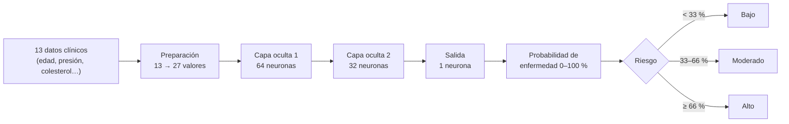

# La red neuronal de HeartGuard

> **Para quién es este documento:** para cualquier persona que use o evalúe HeartGuard, tenga o no formación técnica. Las secciones 1 a 9 se leen sin saber programar. La sección 10 es la referencia técnica.

> ⚠️ **Aviso importante:** la red neuronal es una **herramienta de apoyo**. Calcula una probabilidad a partir de datos clínicos, pero **no sustituye el diagnóstico de un médico**. Se construyó con fines académicos y con un conjunto de datos pequeño.

---

## Índice
1. [En una frase](#1-en-una-frase)
2. [Qué hace y qué no hace](#2-qué-hace-y-qué-no-hace)
3. [Con qué datos aprendió](#3-con-qué-datos-aprendió)
4. [Las 13 variables que analiza](#4-las-13-variables-que-analiza)
5. [Cómo está construida](#5-cómo-está-construida)
6. [Cómo aprendió](#6-cómo-aprendió)
7. [Cómo toma una decisión](#7-cómo-toma-una-decisión)
8. [Qué tan bien funciona](#8-qué-tan-bien-funciona)
9. [Cómo se usa dentro de HeartGuard](#9-cómo-se-usa-dentro-de-heartguard)
10. [Referencia técnica](#10-referencia-técnica)
11. [Qué se corrigió respecto a la versión original](#11-qué-se-corrigió-respecto-a-la-versión-original)
12. [Limitaciones](#12-limitaciones)
13. [Próximas mejoras](#13-próximas-mejoras)
14. [Glosario](#14-glosario)

---

## 1. En una frase

La red neuronal recibe **13 datos clínicos** de un paciente (edad, presión arterial, colesterol, resultados del electrocardiograma, etc.) y devuelve **la probabilidad, de 0 % a 100 %, de que tenga enfermedad cardíaca**.

## 2. Qué hace y qué no hace

| ✅ Sí hace | ❌ No hace |
|---|---|
| Estima la probabilidad de enfermedad cardíaca a partir de 13 variables. | No da un diagnóstico. La última palabra la tiene siempre el médico. |
| Clasifica el resultado en riesgo **bajo**, **moderado** o **alto**. | No ve imágenes, síntomas descritos en texto ni la historia clínica completa. |
| Ayuda a priorizar: qué pacientes revisar primero y a quién enviar una alerta. | No funciona bien con valores fuera de lo que vio al aprender (por ejemplo, pacientes menores de 29 o mayores de 77 años). En ese caso el informe se guarda **sin predicción** y la app lo avisa. |
| Mejora con el tiempo si los médicos confirman diagnósticos (reentrenamiento controlado). | No aprende sola ni cambia sin supervisión. Un modelo nuevo solo se activa si no es peor que el actual. |

## 3. Con qué datos aprendió

- **Fuente:** el conjunto de datos público *Heart Disease* de la Clínica Cleveland (UCI, 1988), en la versión que circula en Kaggle (`heart.csv`).
- **Tamaño:** 303 pacientes reales. Había un registro duplicado, así que se usaron **302**.
- **Resultado conocido de cada paciente:** si tenía o no enfermedad cardíaca. En total son **138 con enfermedad** y **164 sin enfermedad**.

### Un detalle importante: la etiqueta estaba al revés

En el archivo de Kaggle la columna del resultado (`output`) se describe como "1 = mayor probabilidad de ataque cardíaco". Al analizar los datos se comprobó que en realidad **está invertida**. Los pacientes marcados con 1 eran más jóvenes, alcanzaban una frecuencia cardíaca máxima más alta y tenían menos arterias afectadas, que son rasgos de personas **sanas**. Además, su número coincide exactamente con el grupo "sin enfermedad" del estudio original.

Por eso la red se entrena con la etiqueta corregida (**enfermedad = 1 − output**). La versión original de HeartGuard no tenía esta corrección, así que **sus predicciones salían al revés**. A un paciente de alto riesgo le daba 0,8 % y ahora le da 85 %.

### ¿Y los 10 000 pacientes de la base de datos?

Los 303 primeros informes son los pacientes reales del estudio. Los otros ~9 700 son **pacientes sintéticos** (inventados por un programa a partir de los reales) que se crearon para poblar la aplicación. **No se usan para entrenar** porque no aportan información nueva. Su resultado era la predicción, invertida, del modelo antiguo, no un diagnóstico.

## 4. Las 13 variables que analiza

| Variable | Qué es, en palabras sencillas | Valores |
|---|---|---|
| `age` | Edad del paciente | 29 a 77 años |
| `sex` | Sexo biológico | 0 = mujer, 1 = hombre |
| `cp` | Tipo de dolor en el pecho | 0 = sin dolor (asintomático), 1 = angina atípica, 2 = dolor no relacionado con el corazón, 3 = angina típica |
| `trtbps` | Presión arterial en reposo | mm Hg (94 a 200) |
| `chol` | Colesterol en sangre | mg/dl (126 a 564) |
| `fbs` | Azúcar en ayunas mayor que 120 mg/dl | 0 = no, 1 = sí |
| `restecg` | Resultado del electrocardiograma en reposo | 0 = hipertrofia del ventrículo izquierdo, 1 = normal, 2 = alteración de la onda ST-T |
| `thalachh` | Frecuencia cardíaca máxima en la prueba de esfuerzo | latidos por minuto (71 a 202) |
| `exng` | Dolor de pecho provocado por el ejercicio | 0 = no, 1 = sí |
| `oldpeak` | Cuánto baja el segmento ST del electrocardiograma con el esfuerzo (señal de falta de riego) | 0 a 6,2 |
| `slp` | Forma de la curva ST en el esfuerzo máximo | 0 = descendente, 1 = plana, 2 = ascendente |
| `caa` | Número de arterias principales con obstrucción visible | 0 a 3 (4 = dato faltante) |
| `thall` | Resultado de la gammagrafía con talio (riego del corazón) | 1 = defecto fijo, 2 = normal, 3 = defecto reversible (0 = dato faltante) |

## 5. Cómo está construida

### La idea, con una analogía

Imagina un comité de evaluadores organizado en filas:

1. **Recepción (preparación de datos):** traduce los 13 datos a un formato común. Por ejemplo, el "tipo de dolor" (0, 1, 2 o 3) se convierte en cuatro casillas de sí/no, porque esos números son categorías y no cantidades. Las medidas se ponen en la misma escala para que el colesterol (cientos) no pese más que la edad (decenas) solo por ser un número mayor. Así, 13 datos se convierten en **27 valores**.
2. **Primera fila: 64 evaluadores.** Cada uno mira los 27 valores y busca un patrón distinto, como "presión alta y edad avanzada".
3. **Segunda fila: 32 evaluadores.** Combinan las conclusiones de la primera fila en patrones más complejos.
4. **Decisión final: 1 evaluador.** Junta todo en un único número, que se convierte en una probabilidad entre 0 % y 100 %.

Cada evaluador tiene sus propios **pesos** (cuánta importancia le da a cada dato). Esos pesos no los programó nadie a mano: la red los **aprendió** a partir de los ejemplos.

### El esquema

### Dos técnicas para que no "memorice"

Con solo 302 pacientes existe el riesgo de que la red se aprenda los casos de memoria en lugar de entender el patrón general, como un estudiante que memoriza las respuestas del examen. Para evitarlo se usan:

- **Dropout (30 %):** durante el aprendizaje se "apaga" al azar el 30 % de los evaluadores en cada ronda. Así ninguno puede depender de un compañero concreto y todos aprenden patrones más robustos.
- **Parada temprana:** se detiene el entrenamiento en cuanto la red deja de mejorar con pacientes que no está usando para aprender (ver la sección 6).

### Ficha técnica rápida

| Elemento | Valor |
|---|---|
| Tipo de red | Perceptrón multicapa (MLP), red neuronal "densa" |
| Capas | 27 entradas → 64 → 32 → 1 salida |
| Función de activación | ReLU (cada neurona solo "se activa" con señales positivas) |
| Regularización | Dropout 0,3 y *weight decay* 0,0001 |
| Total de pesos aprendidos | 3 905 |
| Biblioteca | PyTorch |

## 6. Cómo aprendió

1. **Se separaron los pacientes en tres grupos**, manteniendo la misma proporción de enfermos en cada uno:
   - **210 para aprender** (entrenamiento),
   - **46 para vigilar el aprendizaje** (validación),
   - **46 guardados bajo llave para el examen final** (test). La red nunca los vio mientras aprendía.
2. **Rondas de práctica (épocas):** en cada ronda la red ve los 210 pacientes en grupos de 32, compara su predicción con el resultado real y ajusta un poco sus pesos para equivocarse menos. El ajuste lo hace el algoritmo **Adam** con una velocidad de aprendizaje de 0,001.
3. **Vigilancia:** tras cada ronda se mide el error en los 46 pacientes de validación. La mejor ronda fue la **10**. Como en las 30 rondas siguientes no mejoró, el entrenamiento se detuvo en la ronda 40 y se conservó la versión de la ronda 10.
4. **Examen final:** se evaluó una sola vez con los 46 pacientes de test. Esos son los resultados de la sección 8.
5. **Segunda opinión (validación cruzada):** como 46 pacientes son pocos para fiarse de un solo examen, se repitió el proceso 5 veces con particiones distintas y se promediaron los resultados.
6. **Reproducible:** todo usa una semilla fija (42). Si se vuelve a entrenar, se obtiene exactamente el mismo modelo.

## 7. Cómo toma una decisión

La red siempre entrega **una probabilidad**. A partir de ella, la aplicación muestra dos cosas distintas:

| Concepto | Para qué sirve | Regla |
|---|---|---|
| **Nivel de riesgo** | Comunicar la gravedad de forma sencilla, en la pantalla y en las alertas. | Bajo: menos de 33 %. Moderado: de 33 % a 66 %. Alto: 66 % o más. |
| **Predicción sí/no** | Decidir si el caso se clasifica como "probable enfermedad". | Sí, si la probabilidad es al menos **34,5 %**. |

**¿Por qué 34,5 % y no 50 %?** Ese umbral se eligió estadísticamente para equilibrar los aciertos en enfermos y en sanos. En la práctica hace que la red **prefiera dar una falsa alarma a dejar pasar a un enfermo**, que es lo prudente en cardiología.

**Ejemplo.** Un paciente obtiene 45 %. Su nivel de riesgo es **moderado** y la predicción es **sí, probable enfermedad**, porque supera el 34,5 %. Las dos cosas son coherentes: el riesgo no es extremo, pero conviene estudiarlo.

## 8. Qué tan bien funciona

### Resultados en el examen final (46 pacientes que la red nunca vio)

| Medida | Resultado | Qué significa |
|---|---|---|
| **Detección de enfermos (sensibilidad)** | **90,5 %** | De 21 enfermos, detectó 19. |
| **Precisión de las alarmas** | 76 % | De cada 4 alarmas, unas 3 eran enfermos reales. |
| **Aciertos totales (exactitud)** | 82,6 % | Acertó en 38 de los 46 pacientes. |
| **Capacidad de distinguir (ROC-AUC)** | **0,92** | Si se toma un enfermo y un sano al azar, en el 92 % de los casos la red le asigna más riesgo al enfermo. 1 sería perfecto y 0,5 sería tirar una moneda. |

**El detalle de los 46 pacientes:**

| | La red dijo "sano" | La red dijo "enfermo" |
|---|---|---|
| **Realmente sano (25)** | 19 ✅ | 6 (falsas alarmas) |
| **Realmente enfermo (21)** | 2 (no detectados) | 19 ✅ |

### Con la "segunda opinión" (5 repeticiones)
Aciertos 83,6 % ± 5 % · ROC-AUC 0,90 ± 0,03. Es una estimación más fiable que el examen único, porque usa más pacientes.

### Comparación honesta
Se comparó con un modelo estadístico clásico y mucho más simple, la **regresión logística**. **Los dos rinden prácticamente igual** (ROC-AUC 0,92 en el examen y 0,90 en la segunda opinión). Esto indica que el límite lo pone la cantidad de datos (302 pacientes) y no la complejidad del modelo. Lo detalla la sección 13.

## 9. Cómo se usa dentro de HeartGuard

La red neuronal es **una herramienta dentro del sistema de gestión**, no el sistema en sí. Aparece en estos puntos:

| Dónde | Quién | Qué pasa |
|---|---|---|
| **Nuevo informe** | Médico | Al guardar los 13 datos de un paciente, la red calcula su probabilidad y su nivel de riesgo, que quedan guardados en el informe. Si el riesgo es **alto**, se envía una alerta automática al paciente. |
| **Predicción rápida** | Médico | Prueba "¿qué pasaría si…?" sin guardar nada. |
| **Detalle del informe** | Médico | Ve la predicción, puede **confirmar el diagnóstico real** y pedir que se vuelva a calcular. |
| **Panel y análisis** | Médico | Distribución de pacientes por nivel de riesgo y pacientes que requieren atención. |
| **Mis resultados** | Paciente | Ve su último resultado, la evolución de su riesgo en el tiempo y el aviso de que no es un diagnóstico. |
| **Modelo IA** | Médico / Admin | Métricas, curvas de aprendizaje, versiones del modelo y botón para **reentrenar** (solo admin). |

### Cómo mejora con el tiempo (reentrenamiento)

1. Los médicos **confirman diagnósticos reales** en los informes.
2. Un administrador pulsa **Reentrenar**, o lo lanza con el comando `reentrenar_modelo`. Nunca ocurre automáticamente.
3. Se entrena un modelo candidato con los datos originales más los diagnósticos confirmados.
4. El candidato y el modelo actual hacen **el mismo examen**. El candidato solo se activa si **no es peor**. Si lo es, se archiva y no cambia nada.
5. Cada versión queda guardada (2.0.0, 2.1.0…) con su bitácora, así que siempre se sabe qué modelo hizo cada predicción (campo `modelo_version` del informe).

## 10. Referencia técnica

| Qué | Dónde |
|---|---|
| Paquete de la red (entrenamiento, preprocesado, predicción) | Repo [`heart-disease-prediction-neural-network`](https://github.com/JulianMediina/heart-disease-prediction-neural-network), `src/heart_nn/` |
| Servicio de IA dentro de HeartGuard | `HeartGuard/ml/service.py` (`predict`, `predict_many`, `model_info`, `retrain`) |
| Modelo activo y versiones | `HeartGuard/ml/artifacts/ACTIVE` y `HeartGuard/ml/artifacts/<versión>/` (`model.pt`, `preprocessor.joblib`, `metadata.json`, `metrics.json`, `history.json`) |
| Datos base | `HeartGuard/ml/data/heart.csv` |
| Endpoints | `POST /api/v1/ml/prediccion`, `GET /api/v1/ml/modelo`, `GET /api/v1/ml/features`, `POST /api/v1/ml/reentrenar`; la predicción automática corre al hacer `POST /api/v1/informes` |
| Comandos | `python manage.py reentrenar_modelo`, `predecir_informes`, `sanear_informes_legado` |
| Detalle técnico del servicio | [`HeartGuard/ml/README.md`](../HeartGuard/ml/README.md) |
| Auditoría | [`docs/AUDIT.md`](AUDIT.md) |

**Configuración de entrenamiento (versión 2.0.0):** semilla 42; partición estratificada 70/15/15; BCE con logits; Adam (lr 0,001, weight decay 1e-4); lote 32; máximo 500 épocas, paciencia 30 (mejor época 10, índice 9 en `history.json`); one-hot en `cp`, `restecg`, `slp`, `caa`, `thall` y estandarización en el resto; umbral de Youden sobre predicciones *out-of-fold* de la validación cruzada (0,3446); CV estratificada de 5 folds. La elección de BCE frente a Focal Loss y de one-hot frente a ordinal se hizo por validación cruzada (`model_selection.json`).

## 11. Qué se corrigió respecto a la versión original

| Problema en la versión original | Efecto | Estado |
|---|---|---|
| Etiqueta del dataset invertida | Las predicciones salían **al revés** | ✅ Corregido |
| El modelo se reentrenaba solo al iniciar la app y **cada vez que se guardaba un informe**, y en ese momento enviaba correos masivos | Resultados impredecibles y correos no deseados | ✅ Eliminado; ahora se reentrena solo a mano, con control |
| El examen final se usaba también para decidir cuándo parar de entrenar | Resultados demasiado optimistas | ✅ Ahora hay grupos separados |
| La escala de los datos se calculaba con todos los pacientes, incluidos los del examen | "Copiar" información del examen | ✅ Se calcula solo con los de entrenamiento |
| Se guardaba el modelo de la última ronda, no el mejor | Peor modelo | ✅ Se guarda el mejor |
| No se guardaba la escala de los datos junto al modelo | Predicciones incorrectas con datos nuevos | ✅ Se guardan juntos |
| Resultados distintos en cada ejecución | No reproducible | ✅ Semilla fija |
| Categorías tratadas como números | Peor aprendizaje | ✅ Codificación one-hot |

## 12. Limitaciones

- **Pocos datos:** 302 pacientes de un solo hospital (Cleveland, 1988). No sabemos cómo funciona en otras poblaciones.
- **El examen final es pequeño** (46 pacientes), así que sus cifras pueden variar ±7 puntos. La "segunda opinión" es más fiable.
- **La probabilidad no está calibrada:** todavía no se ha comprobado que un "70 %" signifique realmente 7 de cada 10 casos. Las bandas de riesgo son orientativas.
- **No explica sus decisiones:** hoy no dice qué datos pesaron más en cada paciente.
- **Rango limitado:** fuera de los valores que vio (por ejemplo, edad 29–77) no predice.
- **Datos faltantes:** los códigos de "dato faltante" (`caa = 4`, `thall = 0`) se tratan como una categoría más.

## 13. Próximas mejoras

Ordenadas por impacto. La mayoría no requieren datos nuevos:

1. **Calibrar la probabilidad** para que un "70 %" signifique realmente 70 %. Es clave para las bandas de riesgo y las alertas.
2. **Explicar cada predicción** ("este resultado se debe sobre todo a la depresión del ST y a 2 arterias afectadas") para que el médico pueda valorarla.
3. **Mostrar un margen de incertidumbre**, por ejemplo "72 % (65–79 %)", combinando varios modelos.
4. **Ajustar el umbral según el criterio clínico**, por ejemplo garantizando una sensibilidad mínima.
5. **Más datos y validación externa:** sumar los otros tres hospitales del estudio UCI (Hungría, Suiza y Long Beach, ~920 pacientes) y los diagnósticos confirmados en HeartGuard.
6. **Comparar modelos de forma rigurosa** (red neuronal, regresión logística, gradient boosting o una combinación) con validación cruzada anidada.

## 14. Glosario

| Término | Significado |
|---|---|
| **Red neuronal** | Programa formado por capas de "neuronas" (operaciones matemáticas simples) que aprende patrones a partir de ejemplos. |
| **Neurona** | Unidad que suma sus entradas, cada una multiplicada por un peso, y decide cuánto "activarse". |
| **Peso** | La importancia que una neurona da a cada dato. Se aprende, no se programa. |
| **Capa oculta** | Fila intermedia de neuronas entre los datos de entrada y la respuesta. |
| **Entrenamiento** | Proceso de ajustar los pesos mostrando ejemplos con su resultado conocido. |
| **Época** | Una pasada completa por todos los pacientes de entrenamiento. |
| **Validación / test** | Pacientes apartados para vigilar el aprendizaje / para el examen final. |
| **Sobreajuste** | Cuando el modelo memoriza los ejemplos en lugar de aprender el patrón general. |
| **Dropout** | Apagar neuronas al azar durante el entrenamiento para evitar el sobreajuste. |
| **Parada temprana** | Detener el entrenamiento cuando deja de mejorar en validación. |
| **Umbral** | Valor de probabilidad a partir del cual se dice "sí". |
| **Sensibilidad (recall)** | Porcentaje de enfermos que el modelo detecta. |
| **Precisión** | De los casos que el modelo marca como enfermos, cuántos lo son de verdad. |
| **ROC-AUC** | Capacidad general de distinguir enfermos de sanos (0,5 = azar, 1 = perfecto). |
| **Validación cruzada** | Repetir el entrenamiento y la evaluación con varias particiones distintas y promediar. |
| **Regresión logística** | Modelo estadístico clásico y simple, usado como punto de comparación. |
| **Calibración** | Que las probabilidades coincidan con la frecuencia real de los casos. |
